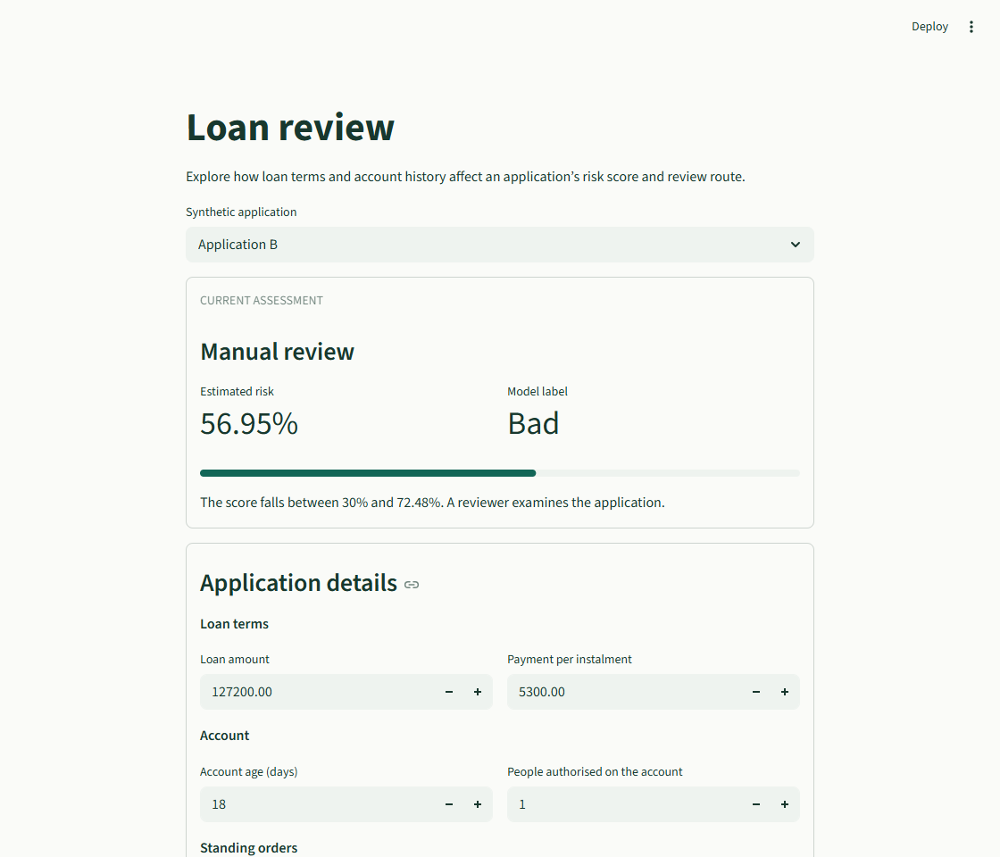

# Bank Credit Decision Support

An interactive credit review demo from a three-person academic project. Change a loan’s terms or pre-loan account history to see its estimated risk, **Good/Bad** label and recommended review route.

[Run the demo](#run-the-demo) · [Model results](#model-results) · [Vietnamese technical report](docs/ket-qua-mo-hinh.md)



## Team & my contribution

My contributions covered handling class imbalance, comparing candidate models, selecting the final pipeline and integrating its predictions into the loan review workflow. The group’s original React, Node.js and MySQL application is in [team-app](team-app/). The Streamlit portfolio demo runs the same scoring logic on synthetic applications and keeps inputs in the browser session’s server-side state.

## Run the demo

Use Python 3.13. From the repository root, create and activate a virtual environment, then run:

```sh
python -m pip install -r requirements.txt
python -m streamlit run streamlit_app.py
```

The model and three invented profiles are bundled. Select **Application B** to start with a 56.95% risk score. Its model label is **Bad**, and its policy outcome is **Manual review**. Edit an input and select **Score application** to recalculate.

| Risk score before rounding | Recommended action |
| --- | --- |
| Up to and including 30% | Auto-approve |
| Above 30% and below 72.48% | Manual review |
| 72.48% or above | Recommend rejection |

## Model results

Only 76 of 682 loans belong to the Bad class. The team compared class weighting, SMOTE and random undersampling with stratified 5-fold validation on the training set. The final XGBoost classifier weights the positive class and uses 12 numeric features selected with SHAP.

| Candidate | CV F1 (Bad) | CV average precision | 0.6 × F1 + 0.4 × AP |
| --- | ---: | ---: | ---: |
| Balanced random forest | 0.4829 | 0.7882 | 0.6050 |
| Random forest with 5:1 sample weights | 0.5488 | 0.8008 | 0.6496 |
| LightGBM, top 12 | **0.7412** | 0.8215 | 0.7733 |
| XGBoost, top 12 | 0.7391 | **0.8410** | **0.7799** |

The training notebook selected XGBoost using the weighted score above. On the **137-loan holdout**, at the model threshold of 0.5, it identified **10 of 15** bad loans, missed five and flagged two good loans. Positive-class F1 was **0.7407**, average precision **0.7003** and ROC-AUC **0.9240**. SHAP selection preceded cross-validation on the training set. These are the original study’s saved results. [Experiment metrics](models/model_metrics.json) · [SHAP summary](docs/figures/shap_summary_xgb_step7.png)

## Reproduction and testing

The [notebooks](notebooks/) cover data exploration, the imbalance and baseline comparison, and final model selection. Their raw row previews and execution outputs were cleared for publication. Retraining requires the original data directory, including the `completedtrans.csv` transaction table missing from the supplied dataset. The demo only needs the included fitted pipeline. The local team app uses a shared development account and is included as a reference implementation.

To check parity with the original predictor, test risk boundaries and exercise the form:

```sh
python -m pip install pytest==9.0.2
python -m pytest -q
```

To deploy on Streamlit Community Cloud, select this repo, branch `main`, entrypoint `streamlit_app.py`, and Python 3.13.
